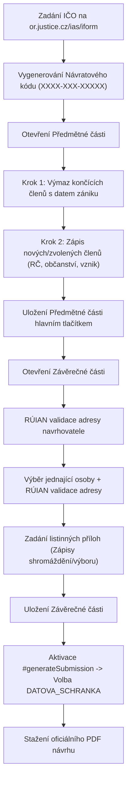

# Skill: justice-iform – Automatizace podání do veřejného rejstříku

Tento skill slouží k automatizovanému vyplňování a generování elektronických návrhů na zápis nebo změnu zapsaných údajů ve veřejném rejstříku (rejstřík společenství vlastníků jednotek, obchodní rejstřík, spolkový rejstřík) na oficiálním portálu Ministerstva spravedlnosti ČR:
👉 **`https://or.justice.cz/ias/iform`**

---

## 1. Co skill řeší

1. **Založení a obnovení návrhu:**
   - Založení nového návrhu podle IČO subjektu (automatické předvyplnění platných údajů z rejstříku).
   - Správa a obnova rozpracovaných návrhů pomocí **návratového kódu** (formát `XXXX-XXX-XXXXX`).
2. **Statutární orgány (výbor SVJ / jednatelé):**
   - Hromadný či selektivní výmaz funkcionářů, kterým skončilo funkční období, s nastavením přesného data zániku funkce a členství.
   - Zápis nových nebo znovuzvolených členů, doplnění rodných čísel, místa narození, občanství a vzniku funkcí.
   - Správné ošetření řadových členů výboru (člen výboru nemá samostatnou funkci).
3. **Závěrečná část a RÚIAN validace:**
   - Automatická validace a provázání adres s kódem **RÚIAN** u navrhovatele i jednající osoby (bez toho systém justice.cz neumožní vygenerovat finální podání).
   - Výběr jednající osoby ze zapsaných osob subjektu.
   - Zaevidování všech listinných příloh (zápisy ze shromáždění, zápisy z jednání výboru apod.).
4. **Generování a stažení podání:**
   - Trvalé uložení rozpracovaného stavu na serveru justice.cz.
   - Nastavení způsobu podepsání na **`DATOVA_SCHRANKA`** (nebo uznávaný el. podpis).
   - Stažení oficiálního vícesránkového PDF návrhu připraveného k odeslání rejstříkovému soudu.

---

## 2. Rychlé použití (CLI)

Automatizační skript je umístěn v:
`scripts/justice_iform.py`

### Příkaz ke spuštění přes JSON konfiguraci:
```bash
python .agents/skills/justice-iform/scripts/justice_iform.py \
  --config .agents/skills/justice-iform/examples/vybor_svj_example.json \
  --output-pdf agenda/zapisy/navrh_rejstrik_podani.pdf
```

### Volitelné přepínače:
- `--config`, `-c`: Cesta ke konfiguračnímu souboru JSON.
- `--output-pdf`, `-o`: Cesta k cílovému souboru vygenerovaného PDF (výchozí: `navrh_rejstrik_podani.pdf`).
- `--headed`: Spustí Chromium s viditelným grafickým oknem (vhodné pro vizuální ladění).

---

## 3. Struktura konfiguračního JSONu

Struktura pro zápis změn statutárního orgánu SVJ:

```json
{
  "ico": "24239178",
  "return_code": null,
  "signing_method": "DATOVA_SCHRANKA",
  "court": "Městský soud v Praze (IDDS: snkabbm)",
  "deletions": [
    {
      "date": "18.11.2025"
    }
  ],
  "additions": [
    {
      "search_name": "VERONIKA",
      "rodne_cislo": "765924/0270",
      "obcanstvi": "Stat[293]",
      "rodne_prijmeni": "Šedivá",
      "stat_narozeni": "cz",
      "okres_narozeni": "Praha",
      "misto_narozeni": "Praha",
      "funkce": "předseda výboru",
      "funkce_od": "18.11.2025",
      "clenstvi_od": "18.11.2025"
    },
    {
      "search_name": "LENKA",
      "rodne_cislo": "765330/0391",
      "obcanstvi": "Stat[293]",
      "rodne_prijmeni": "Mikolášová",
      "stat_narozeni": "cz",
      "okres_narozeni": "Praha",
      "misto_narozeni": "Praha",
      "funkce": "člen výboru",
      "funkce_od": null,
      "clenstvi_od": "18.11.2025"
    }
  ],
  "signatory": {
    "search_name": "VERONIKA",
    "validate_ruian": true,
    "ruian_filter": "Letohradská"
  },
  "attachments": [
    {
      "name": "Zápis ze 14. shromáždění SVJ konaného dne 18. 11. 2025",
      "count": 1
    }
  ]
}
```

> [!IMPORTANT]
> **Pravidlo pro řadové členy výboru (`funkce: "člen výboru"`):**
> Hodnota `funkce_od` MUSÍ být nastavena na `null` (nebo prázdný řetězec). Řadový člen výboru nezastává specifickou funkci, proto se datum vzniku funkce nezadává. Pokud by byl zadán typ data `PRESNY` bez vyplnění data, portál vyhlásí chybu a nepovolí uložení.

---

## 4. Osvědčený postup (Workflow)



---

## 5. Právní náležitosti a podání

### 5.1 Soudní poplatek za zápis změny (2 000 Kč)
Podle **Položky 11 bod 1 písm. c) Sazebníku soudních poplatků** (příloha k zákonu č. 549/1991 Sb., o soudních poplatcích) činí soudní poplatek za návrh na zápis změny ve veřejném rejstříku **2 000 Kč**.
SVJ na rozdíl od spolků či nadací (§ 11 odst. 1 písm. j)) **není od soudního poplatku osvobozeno**. Poplatek se dle bodu 3 Položky 11 vybírá za návrh pouze jednou bez ohledu na počet zapisovaných nebo vymazávaných osob. Platební údaje a platební QR kód pro úhradu bankovním převodem na účet příslušného soudu systém vygeneruje přímo na 1. straně oficiálního PDF návrhu.

### 5.2 Podání přes datovou schránku
- Podle **§ 22 zákona č. 304/2013 Sb.** a **§ 18 odst. 2 zákona č. 300/2008 Sb.** není u podání zasílaného z datové schránky navrhovatele (SVJ) vyžadován uznávaný elektronický podpis. Identita odesílatele je zaručena autentizací v datové schránce.
- **Příslušný soud pro Prahu:** Městský soud v Praze, IDDS: **`snkabbm`**.

### 5.3 Povinné přílohy podání
Do datové zprávy se přikládají:
1. Vygenerované a stažené PDF podání z justice.cz.
2. Zápis ze shromáždění vlastníků jednotek (potvrzující volbu členů výboru).
3. Prezenční listina ze shromáždění (dokladující usnášeníschopnost).
4. Zápis z ustavující schůze výboru (rozdělení funkcí předsedy a místopředsedy).
5. Čestná prohlášení a souhlasy se zápisem do veřejného rejstříku zvolených členů.

---

## 6. Odkazy na dokumentaci a soubory

- Technický rozbor a Wicket specifika: [architecture_and_traps.md](file:///c:/Users/nikan/data/svj/.agents/skills/justice-iform/reference/architecture_and_traps.md)
- Automatizační Playwright skript: [justice_iform.py](file:///c:/Users/nikan/data/svj/.agents/skills/justice-iform/scripts/justice_iform.py)
- Vzorová konfigurace změn výboru: [vybor_svj_example.json](file:///c:/Users/nikan/data/svj/.agents/skills/justice-iform/examples/vybor_svj_example.json)
